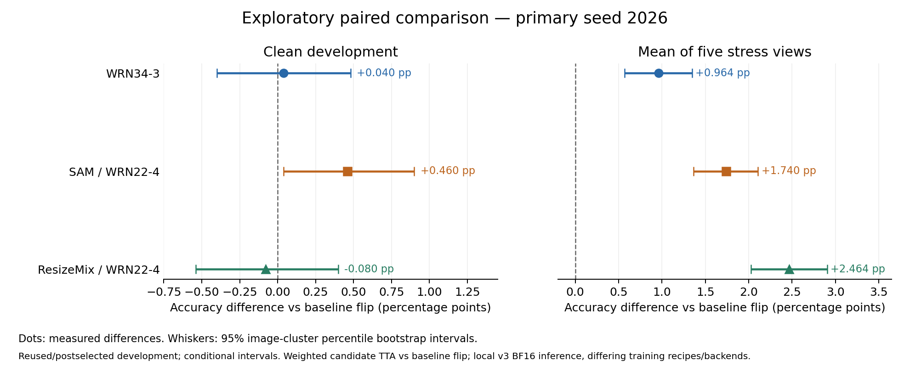

# 五天探索研究：先 benchmark，再晋级

首个 WD 对照已完成 160 轮及完整 benchmark，未通过晋级门槛。
该训练曾中断在第 119 轮，经源码/数据/检查点核验后恢复。中断原因未知，
旧回执及环境记录已保留，该次中断按预留上限保守计入本地预算。
最初原基线的 BN 校准和加权平移 TTA 消融均未通过晋级门槛；后续候选与当前状态见下文。

**材料护照：** `mode=quick` · `sources=verified primary papers/author code + measured local JSON` · `status=exploratory`。记录日期：2026-10-31。

研究窗口和预算以 [campaign.json](campaign.json) 为准。**硬停止时间为
2026-11-05 00:00 America/New_York（EST，UTC-05:00；即 05:00 UTC）**。
截止时停止新实验和提交；监督执行的任务也必须受剩余窗口约束。

## 范围、资源与当前状态

- 原始 160-epoch 主研究、已报告结果和原确认集结论保持冻结。所有新增工作均为探索；
  不再评价原 5,000 张 confirmation 图像，不覆盖原检查点或评分记录。
- 仅使用官方允许的训练图像。开发比较固定为 40,000 张训练、5,000 张 development，
  split seed 2026；最终单个 residual CNN 的总参数和可训练参数均不得超过 5,000,000。
- 用户选择**先用已有 Colab**。官方 CLI 0.7.5 已在 Ubuntu WSL 完成最小权限认证，
  只读余额为 0.00 CU；仅授权 Colab 与基本身份信息，Drive/Cloud 未授权。
  认证成功不代表 GPU 已分配，必须用实际会话、设备和 AMP 预检日志确认。
  不充值，不新增其他 GPU 供应商或付费预算。
- [run_local.py](run_local.py) 已提供本地进程监督、持久 GPU lease、超时和预算账本：
  本地并发 1 个任务、**每 UTC 日最多 6 小时、每个任务最多 3 小时**；训练和完整 benchmark
  都计入任务耗时。Colab 由独立监督器及单独云端 lease 约束，不计入本地 GPU 时间。
- [benchmark.py](benchmark.py) 已实现 6 个 case、3 个推理 policy 和晋级 gate；当前相关
  扩展回归由 CI 验证。WD1e-4 未晋级；WRN34-3 的完整 benchmark、配对核验、独立 seed
  复测和真实预测均完成。SAM 的160轮、完整benchmark和配对已完成，待正式seed复测；
  SWA固定40轮tail及两份完整benchmark完成，clean退化未晋级。SE独立trainer/双门槛benchmark/监督器已实现，原生工程预检通过，尚无正式训练或准确率。AugMix已完成独立CPU变换/损失实现与等价热路径优化，完整流水线仍待预检。

Colab 运行时管理使用 [colab_cli.py](colab_cli.py)，通过官方 0.7.5 entrypoint，
在进程内把请求权限限制为已批准的 Colab/基本身份子集。缓存读取与 refresh 均已实测；
原生凭据留在 WSL 用户目录，目录权限 700、文件 600。`--refresh-auth` 可执行一次
同权限的强制刷新和实际 scope 核验；代码不含任何凭据。Windows 不在官方 CLI 支持范围内，
本机采用现有 Ubuntu WSL；复现安装版本见 [requirements/colab.txt](../requirements/colab.txt)。
运行时分配、真实 GPU 和训练吞吐仍须单独预检，余额为零不代表已获得免费 GPU。

2026-10-31 已实测一台免费 Tesla T4：WRN22-4 为 4,298,970 参数，native FP16、
GradScaler、有限梯度和真实参数更新通过。合成 batch256、dropout0.2、15 步预热和
40 步计时得到 3,760.64 图/秒、中位 68.042ms、P90 68.433ms、峰值 1,024.4MiB。
这不是正式配方的准确率或训练时长估计。预检后 runtime 已停止，active assignments=0，
余额和费率仍为 0；实际缓存过期后的自动 refresh 也通过。公开标量证据见
[research-initial-results.json](../docs/research-initial-results.json)。

原主研究的四个核心文件不因新研究而修改。新实现、配置、日志和产物应单独保存，
每次保留代码/配置/数据分割/检查点/benchmark 的 SHA-256。

最新完整结果见 [research-followup-results.json](../docs/research-followup-results.json)。
WRN34-3 主 seed2026 的加权 policy 为 clean96.32%、stress78.592%；预先固定相同 policy
的 seed2027 复测为96.38%/79.652%，均通过门槛。主模型 clean 的配对区间跨零，
不能声称 clean 显著提高。主模型2,000行CSV和实际离线交付核验完成；10月31日UTC队伍
额度已用尽，等待下一UTC日真实配额。当前实际最佳公开成绩仍为0.874，尚无新增研究评分。
CutMix完成T4 benchmark，配对/复测尚待。ResizeMix补完本地同v3上下文重测与配对；首次配置预检
缺省字段问题已修复且原SHA保留。随后本地正式重复稳态36.2秒/轮，无法在剩余额度内完成，
在9/160轮受控停止、检查点/RNG/GradScaler保留，不能当作效果失败或完整复测。
后续全新T4独立seed2027已完成160轮并核实回收，本地同v3完整重测为96.56%/78.468%，
预先固定的加权policy通过门槛。真实组合证明、主seed2026的2,000行预测和严格离线交付核验均完成，
与WRN34-160一同等待真实UTC配额。重复的stress收益小于主实验，不能据此保证隐藏测试收益。

SAM的固定加权policy为clean **96.74%** / stress **79.368%**，相对本地基线提高0.46和1.74个百分点。
原图聚类配对95%区间分别为 **[+0.04,+0.90]**、**[+1.364,+2.108]**个百分点；全部五个stress case
都有改善。区间仍对已拟合、复用开发集选出的检查点有条件，不能当作新确认或隐藏分数保证。
主seed2026权重/policy和seed2027配置已冻结；正式复测约需一小时，排在UTC预算重置后。

点为主seed2026相对原基线flip的差值，误差线为复用开发集上的条件95%区间；所列候选推理采用同一本地v3上下文。

## 已测结果：不因小幅波动而提交

下面是最初 v1 的完整 5,000 张 development 本地消融，batch size 128。
`stress` 是五个自生成变换的准确率算术平均，不是隐藏测试准确率。

| BN 状态与 policy | Clean accuracy | Mean stress accuracy | 结论 |
| --- | ---: | ---: | --- |
| 原 BN，`flip` | 96.28% | 77.552% | 研究比较基线 |
| 原 BN，`center80_shift20` | 96.32% | 77.756% | 未通过 gate |
| 仅训练集加权校准 BN，`flip` | 95.38% | 77.248% | 未通过 gate |
| 仅训练集加权校准 BN，`center80_shift20` | 95.42% | 77.332% | 未通过 gate |

原始 `regularized` 记录仍为 development 96.30%。新基线 96.28% 与其相差一张图像，
来自不同 batch 设置下的数值差异；不覆盖旧记录，也不将这一个样本的差异解释为模型退化。
新候选使用同一研究基线、分割、case 定义和 batch 设置进行比较，并记录设备与精度。

证据文件保留在忽略的本地路径
`results/research/baseline.json`、`results/research/bn_calibration.json`。
BN 校准仅使用 40,000 张优化训练图像，使用按样本数加权的动量
`batch_size / (seen_examples + batch_size)`，避免末尾小 batch 被赋予同等权重。

后续自动晋级使用 `official_development_stress_v3`。v2 统一使用 CPU 噪声发生器，
逐 case 核对像素 SHA，并绑定完整训练历史、已选检查点指标、源码、设备和 AMP 精度。
v2 基线保存于 `results/research/baseline_v2_verified.json`：
flip 为 clean **96.28%** / stress **77.628%**；加权平移为 **96.32% / 77.756%**，
仍未过 gate。v1 证据作为历史保留，不与 v2 混合用于新晋级。

WD1e-4 的 v2 完整结果：flip 为 **96.18% / 77.108%**，加权平移为
**96.32% / 77.236%**；所有 policy 都失败，不生成隐藏预测或消耗提交次数。

v3 明确用 `is_bf16_supported(including_emulation=False)` 检测原生支持，防止 T4 的
模拟 BF16 被误选；训练、case、像素和 gate 不变。当前配置指向独立重测的
`results/research/baseline_v3_verified.json`；所有新候选须与 v3 同设备/精度基线配对。
旧 v1/v2 证据不覆盖、不混用于 v3 晋级。尚未分配的 v2 Colab 输入包已作废，不能启动。

### Benchmark 定义与晋级条件

六个 case 为 `clean`、高斯噪声 `noise_004`、`boxblur3`、`contrast065`、
`brightness080`、双线性 32→24→32 的 `resize24`。
这些是从允许的 development 图像生成的工程压力代理，**没有加载 CIFAR-C**，
也不能据此诊断隐藏测试分布或解释此前的 development/public 差距。

三个 policy 为 `plain`、中心与水平翻转 logits 平均的 `flip`，以及
`center80_shift20`：80% 中心/翻转结果，加 20% 四个小平移/翻转结果。
同一完整基线下，以下两条满足一条才通过（单位均为百分点）：

1. Clean 提高至少 **0.10**，同时 stress 降低不超过 **0.20**。
2. Stress 提高至少 **0.50**，同时 clean 降低不超过 **0.20**。

这些是预先设置的探索性工程门槛，不是显著性检验。`--limit` smoke 永远不能晋级。
参数/数据分割/检查点来源必须有效；切换设备或精度时保留新旧日志，避免把数值波动当成收益。
通过 gate 仍不保证隐藏测试提升；每次拟提交前都需要完整 benchmark 及产物校验。

## 五个阶段：按证据前进

阶段可以在窗口内提前完成；没有收益时不为满足日程或提交次数而晋级。

| 阶段 | 动作 | 晋级所需证据 |
| --- | --- | --- |
| 1．BN/TTA 与运行时 | 保留上述已完成的否定结果；优先验证已有 Colab 会话和实际 GPU | GPU/AMP 预检、完整基线及不可覆盖的日志 |
| 2．WD 与深宽配置 | 分别试 `wrn22_wd1e4.json` 和 `wrn34_3.json`；保持其余训练协议一致 | 完整 40k/5k benchmark、参数量、耗时和 gate；失败候选不提交 |
| 3．按收益选择扩展 | 先评估低成本 SWA；SAM、SE 仅在实现、资源和预计收益允许时分别验证 | 新实现测试、真实测速、完整 benchmark；不将组合改动称为单因素收益 |
| 4．复测并冻结 | 对晋级 recipe 复测独立训练 seed，固定权重变体、TTA、BN 和训练时长 | 稳定性证据及冻结配置；不重新读取原 confirmation 评分 |
| 5．固定 full refit | 新模型从零使用全部 50k 允许图像重训；按冻结规则做最终推理 | 不报告与训练重叠的 dev 分数；保存单模型检查点、CSV 和完整回执 |

目前可用的本地受监督入口为 `research/run_local.py --run <unique_id> --config <config_path>`。
它调用冻结训练入口并随后执行完整 benchmark，不自动上传 Kaggle。
不要用裸训练命令绕过监督和预算；Colab 路径必须先完成连接及相同的运行/产物检查。
本地实验 ID 和输出路径必须唯一，既有目录、日志和回执不能静默覆盖。

## 方法证据与待验证假设

### 新增可执行路径：FP16 与 CutMix

[train_shadow.py](train_shadow.py) 是独立的探索训练入口，复用冻结核心函数，
仅允许 40k/5k。T4 使用 native FP16 与 GradScaler；溢出跳步不更新 EMA，
检查点保存 scaler、更新次数和全部 RNG，恢复要求源码/精度/配置相同。
额外训练源码由 [benchmark_shadow.py](benchmark_shadow.py) 核验，随后调用未修改的
v3 benchmark；新候选不能只凭兼容核心的字段绕过独立训练源码检查。

[wrn22_cutmix.json](configs/wrn22_cutmix.json) 实现待测 recipe：WRN22-4、160 epoch、
WD5e-4 不变，用 CutMix alpha1、概率0.5 替换 Mixup 和 Cutout。
[实现](augmentations.py) 按实际裁剪面积重新计算标签权重，供体取自未修改的 batch。
依据为 [CutMix 论文](https://arxiv.org/abs/1905.04899)及[作者代码](https://github.com/clovaai/CutMix-PyTorch)；
论文的大模型/训练时长不同，不能移用其准确率。该比较属于配方替换，不是单因素因果消融。

[run_colab.py](run_colab.py) 默认仅准备私有白名单输入包；显式 `--launch` 才申请一次
现有 Colab T4，不充值。它先测真实 GradScaler 正常更新和溢出跳步，再在同一 T4 上重测
可信原始基线，训练候选并运行完整 benchmark，下载核验产物后停止 runtime。
本地父进程 watchdog 与远端官方 `runtime.unassign()` 截止保护约束最长三小时任务；
不确定清理时保留 cloud lease，禁止盲目再申请。
实际长训练、传输和评分须以回执为准；CPU 测试通过不代表这些云端步骤已完成。

首次正式尝试已分配 T4 并建立远端截止保护，但旧资源检查因 0 CU 余额、1.15 CU/h
而提前停止，未上传数据或启动训练，终止和 active=0 已核实。
CLI 的速率来自 `consumptionRateHourly`，不是美元账单字段；[官方 FAQ](https://research.google.com/colaboratory/faq.html)
说明 CU 用完后回到免费层限制。该组合不证明发生新购买；现有权益可继续使用，
仍禁止充值/订阅/外部 GPU。修正后记录实际余额、速率及单个运行时，不因正 CU/h 自动拒绝。

当前扩展回归含实际训练中断恢复后 model/EMA 完全一致、
CutMix 标签面积、源码/更新计数校验、云端未知分配不重试，以及本地恢复归档失败不覆盖旧回执。

### 小幅收益的配对核验

[paired_compare.py](paired_compare.py) 在相同 v3 环境下复算候选 policy 与原基线 flip，
校验输入像素、准确率、检查点/配置/完整历史及 shadow 来源。然后以 **5,000 个原图 ID**
为抽样单位，每次连同五个 stress 视图共同重采样，固定 seed20261031、10,000 次，
输出 clean/stress 差值的95% percentile区间和配对正确/错误计数。只保存聚合结果，
正确性向量留在进程内存。它不覆盖晋级 gate，也不把复用且已选模的 dev 当成新确认集。

仅在对应 GPU 空闲、已有任务结束并按监督/预算记录后运行；不能与持有 lease 的任务并行。
云端 FP16 benchmark 不能直接与本地 BF16 混用；如改到本地复算，先在同一本地环境
完整重测候选和可信原基线。工具的 CPU 合成检查已通过；WRN34-3 的真实配对区间见上述聚合结果。

1. **BN / TTA。** 作者的 [SWA BN 更新代码](https://github.com/timgaripov/swa/blob/master/utils.py)
   使用按 batch 样本数加权的统计更新。[Better Aggregation in Test-Time Augmentation](https://arxiv.org/abs/2011.11156)
   及其[作者代码](https://github.com/divyashan/test-time-augmentation)表明，TTA 即使整体提高准确率，
   也会把部分正确预测变错。当前本地 BN/TTA 结果决定不晋级，不把更多视图视为已有收益。
2. **Weight decay。** [MixUp 作者训练代码](https://github.com/facebookresearch/mixup-cifar10/blob/main/train.py#L35)
   默认使用 `weight_decay=1e-4`；当前候选只把原 recipe 的 `5e-4` 改成 `1e-4`。
   这是待测假设，不是本项目已证明的最佳值。参考算法/参数，独立实现并遵守引用与代码许可要求。
3. **SWA，独立实现/CPU检查完成，尚无真实GPU结果。** 固定40轮tail及严格新seed完整复测的协议见[swa-plan.md](swa-plan.md)。[原论文](https://arxiv.org/abs/1803.05407)和[作者示例](https://github.com/timgaripov/swa#examples)
   支持对 SGD 轨迹权重做平均，最终保留单个模型。作者 CIFAR/WRN 示例从 epoch 161 开始 SWA，
   SWA LR 为 0.05，论文附录WRN设置为0.01。当前备用计划固定40轮、0.01，不临时搜索长度/LR；
   仍须独立40k benchmark、配对和冻结后的正式seed复测，平均后的BN只用40k优化训练图像重估。
4. **SAM，完整160轮与配对已完成、待正式复测。** [原论文](https://arxiv.org/abs/2010.01412)与[作者代码](https://github.com/google-research/sam)
   的 CIFAR-10 WRN-28-10 参考配置使用 LR 0.1、WD 0.0005、rho 0.05。
   迁移到预算内 WRN-22-4 是新假设；原大模型成绩不移用。每次更新需要两次反向传播，
   预算先按约两倍计算并实测。实现须复用相同增强/MixUp、控制第二遍 BN 统计，
   并在 AMP 失败时恢复扰动；不得把未实现算法写成完成结果。
5. **架构候选。** 优先比较现有代码支持的 WRN-34-3，再按收益实现 SE。
   其余两种作为备选，实际实现后重新核验全部参数、数值稳定性、显存和真实吞吐。

| 结构候选 | 设计/CPU 核算参数量 | 核验依据与实现边界 |
| --- | ---: | --- |
| SE-WRN-22-4，r=16 | 4,332,654 | 每个残差支路末端、相加前加带 bias 双 FC 门；增加 33,684 参数。[SE 论文](https://arxiv.org/abs/1709.01507)、[作者实现](https://github.com/hujie-frank/SENet/blob/master/models/SE-ResNet-50.prototxt)。该精确组合尚未实现/训练。 |
| WRN-34-3 | 4,166,298 | 实际40k训练、完整开发benchmark与独立seed复测完成；[WRN 论文](https://arxiv.org/abs/1605.07146)、[作者参数化代码](https://github.com/szagoruyko/wide-residual-networks/blob/master/pytorch/resnet.py)。该精确配置没有可移用的论文成绩。 |
| CIFAR ResNeXt-29，4×24d | 4,845,002 | 按作者 CIFAR 模板核算：hidden 96/192/384，输出 256/512/1024。[论文](https://arxiv.org/abs/1611.05431)、[作者代码](https://github.com/facebookresearch/ResNeXt/blob/master/models/resnext.lua)。尚未实现；不同 baseWidth/expansion 约定须重新计数。 |
| PyramidNet-110，α=84，basic | 3,904,446 | 作者 PyTorch 类 CPU 构造计数；论文近似写 3.8M。[论文](https://arxiv.org/abs/1610.02915)、[作者代码](https://github.com/dyhan0920/PyramidNet-PyTorch/blob/master/PyramidNet.py)。尚未移植；旧 CUDA padding 必须改为匹配 device/dtype，保留其 basic block 设计。 |

所有候选最终都以实际 `model.parameters()` 的总数和 trainable 数复核，包括 BN、捷径、
门控和分类头。文献 CIFAR 实验仅说明方法依据，不能当成当前比赛成绩或提升承诺。
原 `robust_full` 同时改变增强、训练时长、EMA、BN 和 TTA，不能从其结果推断某一个改动的因果作用。

### 下一轮优化器对照：SAM

[sam.py](sam.py)、[train_sam.py](train_sam.py) 与
[benchmark_sam.py](benchmark_sam.py) 是独立入口，不修改当前 CutMix 或原始训练源码。
配方 [wrn22_sam.json](configs/wrn22_sam.json) 保留原 WRN22-4、160轮、WD5e-4、
Cutout16/Mixup0.2，仅加入非自适应 SAM rho0.05。两次前后向复用同一增强批次，
第二遍仍用批次 BN 归一化，但不重复累计运行统计；精确恢复原权重后只做一次 SGD。
当前只验证 CPU FP32 与本地原生 BF16 路径，FP16/scaler 明确拒绝。

SAM 的 CPU检查包含解析二次函数更新、扰动范数、失败恢复、BN只更新一次，
以及实际小模型中断恢复后 model/EMA/SGD/RNG 一致。优化后真实原生 BF16 合成预检完成：
23/23次更新，中位64.183ms，较旧实现107.145ms降低约40%；不含验证和I/O，不能当作完整训练耗时。
160轮正式训练、完整benchmark与配对已经完成，50,080次成功更新、0跳步、100,160次双pass。
主模型第157轮raw检查点已冻结，不能改为按复测分数挑权重。加入组合回执后全套239项 CPU检查通过；
对应源码版本的CI结果见PR8，CPU fixture不等于真实候选配对或提交成功。
本地监督器新增 `--trainer sam --precision bf16`，保存训练器/精度并禁止交叉恢复。
云端与本地时间预算分开计数；活动 Colab 任务不会被误计为本地 GPU 时间。

### 新云端对照：ResizeMix 风格变体

CutMix 已完成完整 T4 FP16 v3 benchmark：加权 policy clean96.22%、stress78.896%，
相对于同 T4 基线，stress提高1.248个百分点、clean降低0.06个百分点，符合工程门槛。
它仍缺配对和独立 seed 证据，尚未获准生成提交。产物已取回，原运行时的服务器 assignment
列表和后续用量均核实为0；首次即时清理检查未收敛，原回执及后续核验均保留。

[train_resizemix.py](train_resizemix.py)、[resizemix.py](resizemix.py) 与
[benchmark_resizemix.py](benchmark_resizemix.py) 独立实现下一轮配方，保持WRN22-4/160轮/WD5e-4，
替换旧Mixup/Cutout。整张供体图缩小后粘贴，tau是均匀0.1到0.8的边长比例，标签按真实面积。
每张图独立采样中心，将完整补丁移入边界，不裁掉供体内容。
[作者代码](https://github.com/JieQin-AI/ResizeMix)使用nearest和始终启用；本轮明确采用
**bilinear、概率0.5**，属于待测的受控变体，不宣称复现作者配方或准确率。

云监督器新增 `--trainer resizemix`，仅在实际方法的CUDA几何、FP16正常更新和测速预检通过后
才运行完整基线与训练；原始训练源码和已冻结WRN34交付文件不改。现已完成160轮及完整benchmark，
加权policy clean96.20%/stress80.092%，同次T4基线96.28%/77.652%，通过点门槛。
收益主要来自blur与resize，noise下降3.02个百分点；不把平均提升写成各case均改善。
产物和运行时回收已核实。本地同v3上下文完整重测保持96.20%/80.092%，本地基线为96.28%/77.628%。
配对stress区间[+2.024,+2.904]个百分点、clean区间[-0.54,+0.40]，主权重/policy已冻结。
本地尝试使用相同源码/算法/FP16，但从T4/Torch2.11换到RTX5060/Torch2.12，仅完成9轮且已容量中止。
后续全新同T4/FP16完整160轮已完成，50,059次成功更新、21次溢出跳步；两份最终推理benchmark
统一在本地v3上下文，独立重复为96.56%/78.468%。固定加权policy通过，plain没有通过；
不更换提前冻结的主2026权重或policy。

[paired_compare_v2.py](paired_compare_v2.py)保留原图聚类bootstrap协议，同时严格核验ResizeMix的
训练来源、scaler和更新次数，并绑定新verifier与旧共享helper的两个SHA。
[delivery_v2.py](delivery_v2.py)独立冻结/复测/预测，上传器按v2 schema深度验证。
本地复测由[run_resizemix_local.py](run_resizemix_local.py)共享lease/预算/watchdog，
显式FP16保持与主模型相同的训练precision，推理统一完整本地v3上下文；不支持隐式恢复。

实际本地FP16重复未完成。云端独立重复、官方回收证明及后续本地同v3重测均已完成。
[repeat_attestation.py](repeat_attestation.py)新增独立组合回执：深验原始云输入/产物ZIP、完整160轮
40k/5k来源与更新、固定policy、原清理证明、本地完整benchmark和真实时间链；开始时间来自云job，
结束时间来自本地benchmark，不改写原回执。仅支持ResizeMix。预测须用
`run_diagnostic.py --mode cloud-repeat-predict`；上传器重新深验该证明，普通v2预测拒绝未知云回执。
真实seed2027组合回执已构建并深度复核；主seed2026隐藏预测和严格`--prepare`通过。
该云目录的实际delivery.run是`candidate`；研究队列另存可读配方名称，不改真实manifest。
尚无上传intent或新评分回执。

[run_diagnostic.py](run_diagnostic.py) 为测速、独立训练器重测与配对比较提供同一个
本地 lease、预算和 watchdog，不用裸 GPU 命令绕过监督。SAM 实际测速入口为
`python research/run_diagnostic.py --run wrn22_sam_native_preflight --mode sam-speed --config research/configs/wrn22_sam.json`。
只有当前训练结束并释放 lease 后才能运行；输出为新目录中的不可覆盖工程证据。

### 新增长程对照：WRN34-3 / 300轮 / T4 FP16

[wrn34_3_300.json](configs/wrn34_3_300.json)保持模型与原增强、WD，仅延长配置中的训练轮数。
云端使用独立shadow原生FP16入口，与同一运行时可信WRN22基线比较；原WRN34-160是本地BF16，
因此不能把跨环境差异归因于训练轮数。主2026已完成T4/nativeFP16的300轮、93,864成功更新/36跳步及完整v3 benchmark；本地v3重测为96.54%/79.716%，配对及epoch298raw/加权策略先冻结。独立2027也完整完成300轮、93,866成功/34跳步；同T4完整benchmark为96.70%/80.532%，回收验证后本地同v3为96.66%/80.584%，固定policy通过。真实组合证明、冻结主2026的2,000行预测及严格离线交付校验均完成，等待实际UTC配额；尚无上传或新评分。

普通Mixup/Cutout的shadow路径新增真实模型级FP16预检：3步预热、10步计时、13次真实更新，
核验所有参数/损失有限、参数<=5M及训练/增强源码SHA。预先固定预算公式为
`1.5 × 测得SGD-only估计 + 300秒`，另外预留180秒传输/清理；完整训练前拒绝不适合的任务。
该余量参考此前同T4 ResizeMix真实epoch耗时/合成SGD估计约1.147。WRN34新实测中位46.056ms，
预检纯SGD估计72.1分钟、保守流水线113.1分钟，符合当前实际剩余窗口；不是完整训练实际耗时。
原ResizeMix预检的2倍预算规则不改，三小时独立截止保护保持。合成预检不产生比赛准确率。

### SWA独立路径与固定选择语义

[train_swa.py](train_swa.py)恢复已审计的本方scratch第160轮raw/EMA/SGD/RNG轨迹，固定追加40轮、
LR0.01，逐epoch做40次FP32参数平均。输出显式`swa`及`raw_tail_control`，不使用旧best-epoch字段；
平均后仅40k训练图像重估BN，SWA与raw对照使用同一crop/flip及随机种子。
[benchmark_swa.py](benchmark_swa.py)使用原v3评分/像素/gate和独立完整来源审计，固定weighted策略
同时通过原regularized和固定WRN34父参照的门槛才可晋级；对照不进入隐藏预测。

[run_swa.py](run_swa.py)共享本地lease/预算/watchdog；先做20步实际原生BF16预检，再按实测余量启动。
主模型只接续精确哈希的本方seed2026末轮检查点；正式seed2027在同一监督任务内重新scratch160+tail40。
两份完整benchmark、BN和I/O均受任务上限。276项全套CPU检查与独立审查通过。首次GPU预检23/23真实原生BF16有限更新，中位108.814ms；固定1.5倍流水线余量和300秒最终化要求2343.52秒，超过当日剩余2154.72秒，未启动正式训练。参数平均有294次逐tensor同步，按device聚合的无穷范数有限性检测现已实现，12项数学检查及278项集成CPU检查通过；不降低预算倍率或更改预检平均频率，新源码必须重新测速。
新源码预检同样23/23真实更新/平均，中位42.691ms、P90 46.592ms。原guard要求1101.74秒，
小于实际剩余2148.45秒；已于19:52:33UTC启动唯一40轮tail+两份完整benchmark监督任务。
现已完整结束626.45秒；weighted SWA为clean95.72%/stress80.18%，相对父模型clean降低0.60个百分点，
未过原基线及父参照clean非劣门槛。相同轨迹/BN的raw-tail对照为94.48%/72.456%。
平均缓解了该轨迹的退化，但不满足晋级；没有配对/重复/隐藏预测，不改LR或挑别的policy挽救本候选。
相对父模型同时改变tail与BN，剩余clean退化原因尚未分离。所有绑定源码/协议和负结果保持可核验。
若在epoch200之后的最终BN/eval阶段中断，当前入口拒绝直接resume，保留原last状态并先核验再处理。
现有v1/v2交付入口不支持SWA，不以改名或旧weight variant替代方法审计。

## 提交与证据

Kaggle 每 **UTC 日、整个队伍合计最多 5 次**。提交前读取实际 API 余额；
只有完整 benchmark 通过、推理规则冻结、CSV 文件 SHA 唯一且本地校验通过的候选才可提交。
没有合格候选时不提交，**不凑满次数**，不重复上传相同预测。

继续使用已有受验证上传流程保存意图、官方 submission reference、文件/检查点/源码 SHA 和评分。
新 research run 只有在接入同等元数据和校验后才可上传，不能绕过 uploader 的 run/source 检查。
原确认集、隐藏标签和外部数据都不用于此轮晋级；隐藏图像只进入最终固定推理和官方提交。
数据、模型权重和预测行保持私有；可发布内容仅限经审计的配置、聚合指标、图表和校验和。

现已为首个合格候选实现独立交付路径：[delivery.py](delivery.py) 先冻结主 seed2026 的
权重/推理 policy 与配对证据，要求选择决定早于独立 seed 复测，复测同一 recipe 和 policy
也须通过完整门槛，才可生成官方2,000行预测。预测使用
`run_diagnostic.py --mode predict` 监督，不占用正在训练的 GPU。
此入口支持有独立开发证据的40k候选；不能把full50k模型伪装成独立验证模型。

[submit_candidate.py](submit_candidate.py) 的 `--prepare` 仅作真实文件校验、不创建上传意图；
`--submit` 重新校验交付链、实际团队配额与 CSV，先持久记录意图再调用官方 CLI/API。
未知上传结果不重传，已知 reference 可用 `--check REF` 只读查询；原五次记录和旧 allowlist 不改。
WRN34 的独立复测、真实2,000行预测和 `--prepare` 已完成，目前等待真实 API 配额。
尚未有新评分；不把 fake API 测试或已生成CSV称为提交成功。

### 按冻结配方全量重训

[run_refit.py](run_refit.py) 为已合格的原始核心 WRN 提供独立50k路径。默认 `--prepare`
只重验已完成的40k交付链、生成不可覆盖的计划与输入配置，不占GPU或预算；显式 `--launch`
才在共享lease/日预算/watchdog内从零训练。只改变 `train_all` 和预先选中的最终权重变体，
其余配方与训练时长继承合格父模型。首次WRN34为160轮。

完整检查50,000训练/0验证、每轮开发指标为null、固定最终轮次/变体、最终权重与last状态完全一致。
[refit_delivery.py](refit_delivery.py) 及 `run_diagnostic.py --mode refit-predict --plan <plan>`
做固定策略推理；上传器只接受经父链和真实full记录深度核验的独立schema。
full模型没有新的独立开发准确率；其依据来自已冻结父配方，不复用重叠dev冒充验证。
该初始全量路径不支持SAM/CutMix/ResizeMix等独立训练器，不能将其强行交给冻结BF16核心。

本地余量由实际账本计算。首次WRN34全量训练估计接近今日SAM后的剩余时间，
计划在2026-11-01 00:00 UTC（10月31日20:00纽约）预算重置并完成更强SAM候选的正式重复后，
以至少3,000秒余量门槛启动。
冻结计划已实际生成并重验父交付链，没有占GPU或创建训练回执；尚未启动全量训练或提交。

每个任务记录实际设备/精度、配置、数据分割、起止时间、预算、训练历史、benchmark、gate 及失败原因。
到停止时间保存现有证据并结束本轮，不以尚未分配的 Colab GPU、尚未运行的算法或未评分的提交宣布完成。

## 下一独立架构：SE-WRN22-4/r16 + 固定SAM

[se_model.py](se_model.py)只实现新单模型，[se-plan.md](se-plan.md)在其GPU实验前固定160轮SAM对照与门槛。
9个带bias门、隐藏4/8/16，共4,332,654总/可训练参数。先完整初始化原WRN再附新门，
同seed共享state keys/初始张量逐项一致，shortcut不门控；8项模型/数学/序列化CPU检查通过，
独立trainer、完整双参照benchmark与监督器已实现，21项新CPU检查和独立审查通过。
原生BF16合成预检现已完成23/23真实更新，全部9门的梯度和参数变化逐步通过；中位61.626ms，
固定guard需4929.32秒，超过当前UTC日剩余约1363秒，尚未正式训练或测准确率。
证据见[se-engineering-results.json](../docs/se-engineering-results.json)。
未来唯一weighted主policy还须通过相对固定SAM主seed2026的增量gate，不能只继承旧SAM收益；
通过完整配对后才冻结并新scratch seed2027。优先完成现有SAM/ResizeMix复测。

SE入口为[train_se_sam.py](train_se_sam.py)、[benchmark_se_sam.py](benchmark_se_sam.py)、
[run_se_sam.py](run_se_sam.py)，配置固定在[wrn22_se_sam.json](configs/wrn22_se_sam.json)。
新typed来源核验9个门、完整50,080更新/100,160两遍、模型/EMA/SGD/RNG及原基线/固定SAM双门槛。
监督器共享原lease/预算/watchdog，只有nativeBF16合成23步的全部9门真实梯度/更新及固定吞吐guard通过，
才允许未来primary2026正式160轮；seed2027须等新配对/冻结路径，没有现成隐藏预测或提交入口。
计时包括增强、SAM两遍和SGD，但不含EMA/逐轮dev/checkpoint I/O，故保留1.5倍率和300秒最终化预算。

WRN34-300现已同本地v3完整重测：weighted96.54%/79.716%，相对本地基线+0.26/+2.088pp；
10,000次原图聚类bootstrap clean条件95%区间[-0.18,+0.72]pp跨0、stress[+1.6719,+2.488]pp为正。
主epoch298raw/weighted和精确seed2027配置已于20:07:28UTC冻结；独立完整重复、本地重测和主模型预测均已完成。
官方assignment缺席和后续usage0核实后，原回执备份保留并完成清理核验；ResizeMix独立seed也已完整结束并核实回收。
原repeat_attestation.py只支持ResizeMix160；WRN300使用下述独立shadow证明schema。

## WRN300专用云重复证明

[shadow_repeat_attestation.py](shadow_repeat_attestation.py)使用显式新schema，只允许已固定hash的
WRN34-3/300、FP16、Mixup/Cutout、全新seed2027；不扩旧ResizeMix160入口。深验原始白名单ZIP/
chunks、精确raw/effective配置、真实300轮/更新与溢出、SGD/EMA/RNG/GradScaler、模型级预检、
完整T4 baseline/candidate、本地同v3完整benchmark与原receipt时间链、官方回收证明。
原通用ZIP/cleanup helper以固定SHA复用且不修改；原cloud.receipt不重写成local训练。
19项新helper及5项路由检查通过，全套310项CPU检查通过。真实旧WRN300配置/末态和预检结构
只读核验通过，旧主实验作为repeat被拒绝。原ready WRN160真实--prepare仍通过，无上传或intent。

新mode为`run_diagnostic.py --mode cloud-shadow-repeat-predict`；uploader显式区分两种云证明schema，
普通predict-v2拒绝云receipt。WRN300seed2027只分配一次，已在22:33UTC完成训练/完整benchmark/产物下载，
22:35官方自有端点缺席、22:38后续usage0均核实。原cleanup未收敛回执字节已保留，附证明及哈希后完成规范reconcile；
未再次stop/unassign。其后本地完整v3、显式shadow证明及只预测冻结主2026均通过，strict`--prepare`不创建intent。
重复虽有更高开发分，主模型仍是预先冻结的epoch298raw，而非重复epoch300EMA。

## 报告与执行Notebook的探索扩展

[research_report_evidence.py](../scripts/research_report_evidence.py)只读取公开聚合及实际新评分回执，
由[build_report.py](../build_report.py)的可选`--research-summary`启用。原主研究、原五次提交、
96.64%一次性confirmation与原PDF/Notebook备份保留；新探索用显式新输出目录。
适配器核验完整v3/同上下文/像素与数据指纹、固定门槛、配对和重复，评分须绑定实际checkpoint、
policy、训练范围及参数量；准备完成、CSV或intent均不算官方得分。
探索PDF添加两页，执行Notebook保留原六cell输出并增加两cell公开聚合/真实回执。
实际预览为八页、八执行cell、四张真实PNG；逐页/逐cell输出/图片与哈希均须审查，最终以最新manifest为准。
原生浏览器工具故障且命令行Edge被自动策略拒绝，HTML整页布局尚未核验；已保存的图片、文本和PDF可直接检查。

已审查的当前执行快照见[Project1_Research_Executed.ipynb](../notebooks/Project1_Research_Executed.ipynb)，
页数、执行输出、来源和产物哈希见[research-report-preview.json](../docs/research-report-preview.json)。
351项CPU检查通过；CI明确安装Notebook结构、真实PNG展示和PDF边界所需的CPU报告依赖，
不在CI启动Notebook kernel。重建时指定未存在的新目录：
`python build_report.py --research-summary docs/research-followup-results.json --output-dir outputs/my_research_preview`。
这是有日期的探索快照，最终报告仍须在截止时按实际评分回执刷新。

## AugMix 独立增强与一致性损失

已按[预登记计划](augmix-plan.md)独立实现[augmix.py](augmix.py)，固定九种PIL操作、三分支、
两独立view与clean-only CE加12倍三分布JSD；未叠加Mixup、SAM或SE。21项CPU检查通过，
包括极端FP16/BF16输入的有限梯度、父随机状态重放、两view随机流隔离及像素/几何边界。
[实现说明](augmix-implementation-notes.md)记录作者精确commit、随机流/归一化/预处理差异和数值设计。
实测合成CPU增强+stack由0.314s/sourcebatch降至0.149s，32组图像/随机trace/output逐位相同；
这是工程诊断，未测传输、GPU、训练或准确率。公开聚合见[augmix-engineering-results.json](../docs/augmix-engineering-results.json)。
独立[trainer](train_augmix.py)、[完整benchmark](benchmark_augmix.py)、[本地监督](run_augmix_local.py)及
[Colab监督](run_colab_augmix.py)已完成CPU实现。固定2个spawn CPU worker/prefetch2，按原图显式PCG64种子，
另存sampler/loader随机状态；epoch边界恢复逐位检查通过。底层引擎支持同配方26/27，当前监督器正式只允许主2026；
未来repeat须经过配对/冻结的新可信入口。FP16 init_scale256明确登记，区别于旧shadow正式默认65536；
不把跨数值协议的差异仅归因于增强。固定官方缓存/NPY头严格校验，ID的实际dtype为Unicode`<U5`，不接受object/pickle。

[进程树保护](process_tree_guard.py)在导入Torch/训练代码前建立独立OS边界：Windows专属非继承Job Object，
POSIX自有session及独立watchdog。12项实际Windows CPU测试覆盖无pool回执子孙、owner/trainer硬死、超时、
部分启动、无关canary及真实双worker DataLoader；显式清理未知时保留并锁住lease。Linux路径由CI实际验证。
不修改原监督器/已绑定源码。仅在真实训练图像的CPU/PIL、queue wait、传输、单3B、完整loss/backward/SGD/EMA
及有限性proof端到端native预检通过后，才考虑正式训练。23正常更新之外单独验证有限loss引发inf梯度时跳过SGD，
保留全部参数/动量/EMA并降低scale；正式进程重新scratch初始化。固定guard为`1.5×median×313×160+300`，
云端另留180秒传输/清理。显存/预算不适合则停止，不降batch、不拆view、不转无JSD挽救。
本地预检不能替代同T4实际准入；当前尚无AugMix正式训练、开发集结果、配对或交付资格。
